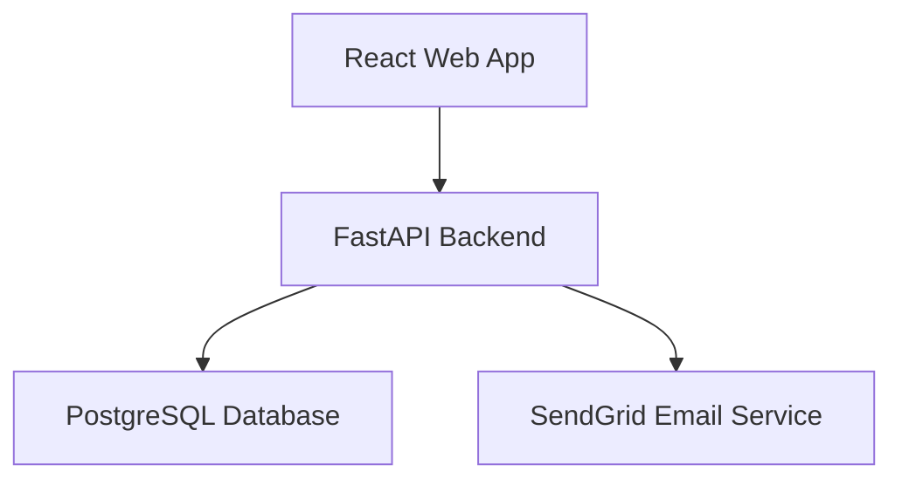
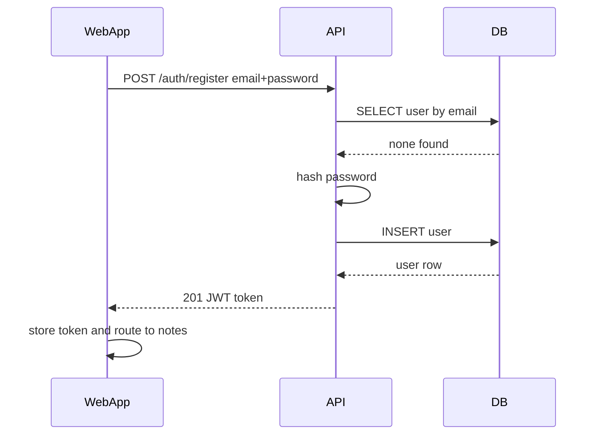
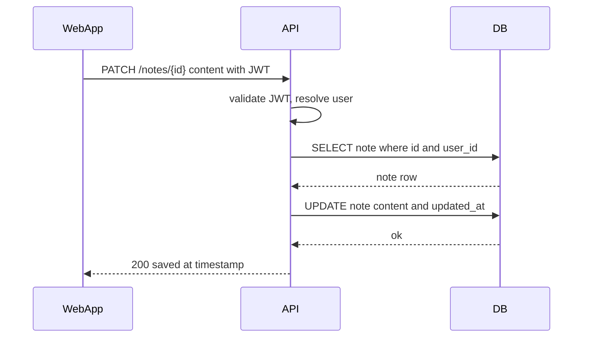
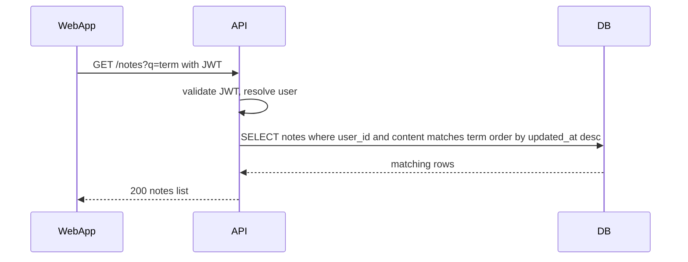
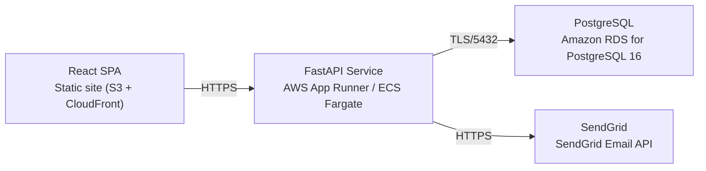

# Architecture

> Maintained by QuorQ AI SDLC. Text between `sdlc:auto` markers is regenerated; anything outside them is yours and is kept.

<!-- sdlc:auto:start narrative -->
## Overview

_No entries for this phase yet._
<!-- sdlc:auto:end narrative -->

<!-- sdlc:auto:start building-blocks -->
## Building Block View

| ID | Name | Technology | Responsibility | Depends on |
|---|---|---|---|---|
| web_app | React Web App | React 19 | Responsive single-page UI for sign-in/registration, notes list, note editor with debounced auto-save and save-status indicator, and text search. Guards routes so only signed-in users reach notes. | api |
| api | FastAPI Backend | FastAPI 0.115 | Exposes REST endpoints for auth (register, login, logout), and per-user note CRUD, list and search. Enforces that every note access is scoped to the authenticated user, hashes passwords, issues/validates JWTs, and triggers password-reset emails. | db, email |
| db | PostgreSQL Database | PostgreSQL 16 | Durable private per-user storage of users and plain-text notes; orders notes by updated time and performs built-in text search over note content. | — |
| email | SendGrid Email Service | SendGrid | Delivers transactional password-reset and account-verification emails to users' inboxes. | — |

<!-- sdlc:auto:end building-blocks -->

<!-- sdlc:auto:start runtime -->
## Runtime View

### Register and sign in

User registers with a unique email and password; the backend validates input, rejects duplicate emails, hashes the password, creates the user and returns a JWT the SPA stores for subsequent calls.

- **Components:** web_app, api, db
- **Modules:** auth_router, auth_service, password_hasher, jwt_provider, user_repository
- **Key functions:** register(email, password), login(email, password), hash_password(password), create_access_token(user_id), get_user_by_email(email)

### Auto-save a note edit

As the user types, the SPA debounces changes and sends updates to the API, which verifies ownership and persists the new content and updated timestamp, returning save status for the indicator.

- **Components:** web_app, api, db
- **Modules:** notes_router, notes_service, notes_repository, auth_dependency
- **Key functions:** update_note(note_id, content, user_id), get_current_user(token), assert_owned(note, user_id)

### List and search own notes

The SPA requests the user's notes ordered most-recent-first, optionally with a search term; the API scopes the query to the user and uses PostgreSQL text matching to filter by content.

- **Components:** web_app, api, db
- **Modules:** notes_router, notes_service, notes_repository, auth_dependency
- **Key functions:** list_notes(user_id, q), search_notes(user_id, term)

<!-- sdlc:auto:end runtime -->

<!-- sdlc:auto:start deployment-view -->
## Deployment View

| Name | Service | Runtime | Scaling | Environment |
|---|---|---|---|---|
| React SPA | Static site (S3 + CloudFront) | Browser bundle (React 19) | CDN edge, static | dev |
| FastAPI Service | AWS App Runner / ECS Fargate | Python container (FastAPI 0.115, Uvicorn) | 1 small instance, scale-out optional | dev |
| PostgreSQL | Amazon RDS for PostgreSQL 16 | Managed PostgreSQL 16 | Single small instance with automated backups | dev |
| SendGrid | SendGrid Email API | External SaaS | Managed by provider | dev |

| Source | Target | Protocol |
|---|---|---|
| React SPA | FastAPI Service | HTTPS |
| FastAPI Service | PostgreSQL | TLS/5432 |
| FastAPI Service | SendGrid | HTTPS |

<!-- sdlc:auto:end deployment-view -->

<!-- sdlc:auto:start decisions -->
## Architecture Decisions

| Layer | Choice | ADR |
|---|---|---|
| Frontend | React 19 | [ADR-0001](adr/frontend.md) |
| Backend | FastAPI 0.115 | [ADR-0002](adr/backend.md) |
| Database | PostgreSQL 16 | [ADR-0003](adr/database.md) |
| Cloud | AWS | [ADR-0004](adr/cloud.md) |
<!-- sdlc:auto:end decisions -->

<!-- sdlc:auto:start links -->
## Related Documents

- [Data Model](data-model.md)
- [API Specification](api/openapi.yaml)
- [Architecture Decision Records](adr/README.md)
<!-- sdlc:auto:end links -->
