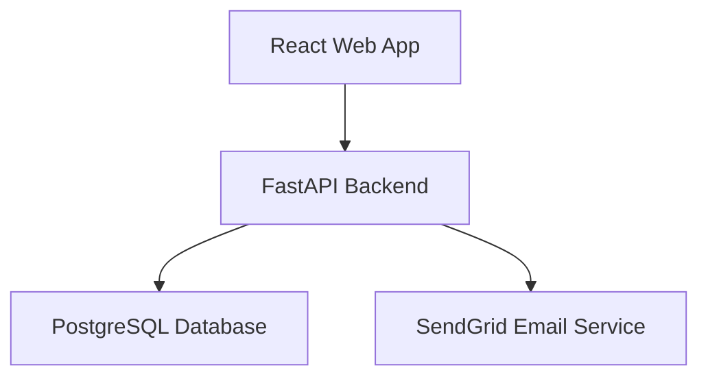
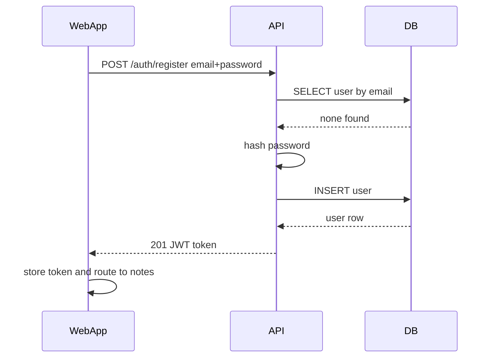
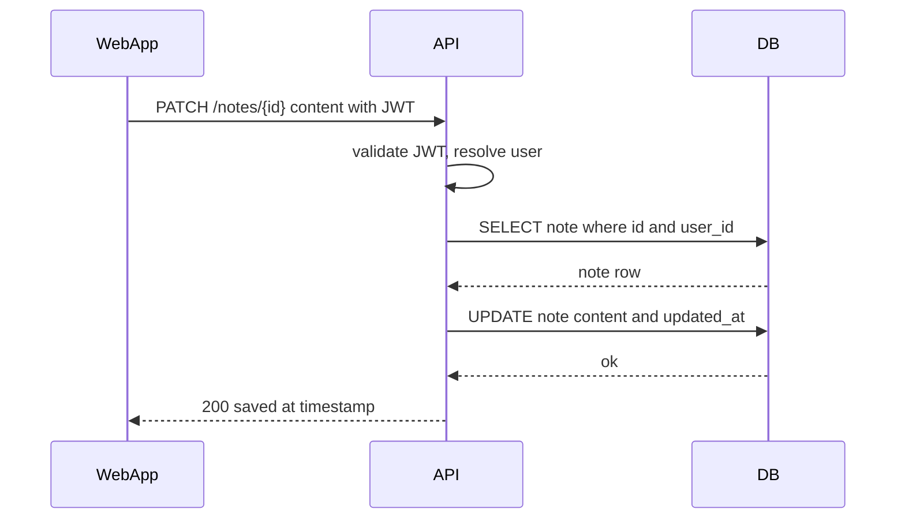
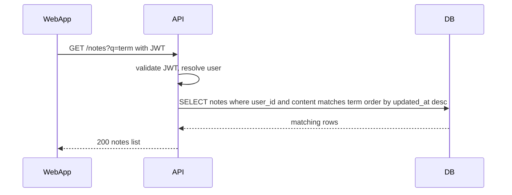
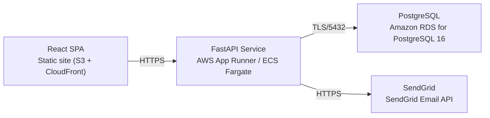

# Architecture

> Maintained by QuorQ AI SDLC. Text between `sdlc:auto` markers is regenerated; anything outside them is yours and is kept.

<!-- sdlc:auto:start narrative -->
## Overview

### ARCH-OVERVIEW · approved · source: architecture:summary

Overall system is a lightweight personal notepad: React 19 SPA + FastAPI 0.115 API + managed PostgreSQL 16 on AWS, with SendGrid for transactional email.

Approved architecture (version 1) describes a single-page web app for individual-scale note-taking. Users register/sign in with email+password (JWT sessions), then create, auto-save, delete and search private, per-user plain-text notes synced across devices via the server. Notes list is ordered most-recently-updated first; search uses PostgreSQL's built-in text matching, avoiding a separate search engine. SendGrid handles password-reset/verification emails. Infrastructure is deliberately kept minimal for modest individual-user scale.

**Related:** US-001, US-002, US-003, US-004, US-005, US-006, US-007, US-008, US-009, US-010, US-011, US-012

- ⚠ Input does not map which of US-001 through US-012 each architectural element satisfies; all 12 requirement keys are linked here at the whole-architecture level only, not per-component -- a human should confirm/refine this mapping.

### ARCH-COMPONENTS · approved · source: architecture:components

Four components: React web app, FastAPI backend, PostgreSQL database, and SendGrid email service.

- web_app: React 19 SPA -- responsive UI for sign-in/registration, notes list, note editor with debounced auto-save and save-status indicator, and text search; guards routes so only signed-in users reach notes.
- api: FastAPI 0.115 backend -- REST endpoints for auth (register, login, logout) and per-user note CRUD/list/search; enforces per-user access scoping, hashes passwords, issues/validates JWTs, triggers password-reset emails.
- db: PostgreSQL 16 -- durable private per-user storage of users and notes; orders notes by updated_at and performs built-in full-text search.
- email: SendGrid -- delivers transactional password-reset and account-verification emails.

- ⚠ No explicit requirement-ID mapping per component was provided in the input.

### ARCH-CRITICAL-PATHS · approved · source: architecture:critical_paths

Three critical paths defined: register/sign-in, auto-save note edit, and list/search notes.

1. Register and sign in: user registers with unique email/password; backend validates input, rejects duplicate emails, hashes password, creates user, returns JWT stored by SPA for subsequent calls.
2. Auto-save a note edit: as user types, SPA debounces changes and sends updates to API; API verifies ownership, persists new content and updated timestamp, returns save status for the UI indicator.
3. List and search own notes: SPA requests user's notes ordered most-recent-first, optionally with a search term; API scopes query to the user and uses PostgreSQL text matching to filter by content.

- ⚠ No explicit requirement IDs were attached to these critical paths in the input.

### ARCH-DATA-MODEL · approved · source: architecture:entities

Three entities: users, notes, and password_resets.

- users: id, email, password_hash, email_verified, created_at.
- notes: id, user_id, content, created_at, updated_at.
- password_resets: id, user_id, token_hash, expires_at, used_at.
All notes are scoped to a user_id, enforcing per-user data isolation at the schema level.

### ARCH-API · approved · source: architecture:endpoints

Ten REST endpoints cover authentication, password reset, and per-user note CRUD/list/search.

Auth: POST /auth/register (unique email + password, rejects duplicates/invalid email/blank password, returns JWT); POST /auth/login (returns JWT, generic error on invalid credentials); POST /auth/logout (client-side token discard); POST /auth/password-reset/request (always returns success to avoid revealing account existence, sends email via SendGrid); POST /auth/password-reset/confirm (sets new password using valid reset token).
Notes: GET /notes (list, most-recently-updated first, optional q param for PostgreSQL text search); POST /notes (create note owned by authenticated user); GET /notes/{id} (fetch single note, denied if not owned); PATCH /notes/{id} (auto-save edit, updates updated_at, returns save status, denied if not owned); DELETE /notes/{id} (delete note owned by authenticated user).

### ARCH-DEPLOYMENT · approved · source: architecture:deployment_nodes

Deployment topology: static SPA on S3+CloudFront, containerized API on App Runner/ECS Fargate, managed RDS PostgreSQL, and SendGrid as external SaaS.

- React SPA: Static site hosting via S3 + CloudFront, delivering the React 19 browser bundle.
- FastAPI Service: AWS App Runner / ECS Fargate running a Python container (FastAPI 0.115, Uvicorn).
- PostgreSQL: Amazon RDS for PostgreSQL 16, managed database.
- SendGrid: External SaaS via SendGrid Email API.

### ARCH-TECH-DECISIONS · approved · source: architecture:technology_decisions

Key technology choices: React 19 frontend, FastAPI 0.115 backend, PostgreSQL 16 database, AWS cloud -- each chosen over named alternatives for fit with the app's scale and simplicity.

- Frontend: React 19 (vs. Vue, Svelte) -- drives the single interactive notes screen with debounced auto-save, live search filtering, save-status indicator, and responsive layout.
- Backend: FastAPI 0.115 (vs. Express, Django REST Framework) -- exposes a small, clear set of auth/note operations via REST with Pydantic validation and a lean footprint suited to individual-user scale.
- Database: PostgreSQL 16 (vs. MySQL, SQLite) -- durable storage, per-user isolation, updated_at ordering, and built-in full-text search without a separate search service.
- Cloud: AWS (vs. Azure, GCP) -- hosts static SPA, container API, and managed RDS PostgreSQL with backups at low cost as the platform default, with minimal setup.
<!-- sdlc:auto:end narrative -->

<!-- sdlc:auto:start building-blocks -->
## Building Block View

| ID | Name | Technology | Responsibility | Depends on |
|---|---|---|---|---|
| web_app | React Web App | React 19 | Responsive single-page UI for sign-in/registration, notes list, note editor with debounced auto-save and save-status indicator, and text search. Guards routes so only signed-in users reach notes. | api |
| api | FastAPI Backend | FastAPI 0.115 | Exposes REST endpoints for auth (register, login, logout), and per-user note CRUD, list and search. Enforces that every note access is scoped to the authenticated user, hashes passwords, issues/validates JWTs, and triggers password-reset emails. | db, email |
| db | PostgreSQL Database | PostgreSQL 16 | Durable private per-user storage of users and plain-text notes; orders notes by updated time and performs built-in text search over note content. | — |
| email | SendGrid Email Service | SendGrid | Delivers transactional password-reset and account-verification emails to users' inboxes. | — |

<!-- sdlc:auto:end building-blocks -->

<!-- sdlc:auto:start runtime -->
## Runtime View

### Register and sign in

User registers with a unique email and password; the backend validates input, rejects duplicate emails, hashes the password, creates the user and returns a JWT the SPA stores for subsequent calls.

- **Components:** web_app, api, db
- **Modules:** auth_router, auth_service, password_hasher, jwt_provider, user_repository
- **Key functions:** register(email, password), login(email, password), hash_password(password), create_access_token(user_id), get_user_by_email(email)

### Auto-save a note edit

As the user types, the SPA debounces changes and sends updates to the API, which verifies ownership and persists the new content and updated timestamp, returning save status for the indicator.

- **Components:** web_app, api, db
- **Modules:** notes_router, notes_service, notes_repository, auth_dependency
- **Key functions:** update_note(note_id, content, user_id), get_current_user(token), assert_owned(note, user_id)

### List and search own notes

The SPA requests the user's notes ordered most-recent-first, optionally with a search term; the API scopes the query to the user and uses PostgreSQL text matching to filter by content.

- **Components:** web_app, api, db
- **Modules:** notes_router, notes_service, notes_repository, auth_dependency
- **Key functions:** list_notes(user_id, q), search_notes(user_id, term)

<!-- sdlc:auto:end runtime -->

<!-- sdlc:auto:start deployment-view -->
## Deployment View

| Name | Service | Runtime | Scaling | Environment |
|---|---|---|---|---|
| React SPA | Static site (S3 + CloudFront) | Browser bundle (React 19) | CDN edge, static | dev |
| FastAPI Service | AWS App Runner / ECS Fargate | Python container (FastAPI 0.115, Uvicorn) | 1 small instance, scale-out optional | dev |
| PostgreSQL | Amazon RDS for PostgreSQL 16 | Managed PostgreSQL 16 | Single small instance with automated backups | dev |
| SendGrid | SendGrid Email API | External SaaS | Managed by provider | dev |

| Source | Target | Protocol |
|---|---|---|
| React SPA | FastAPI Service | HTTPS |
| FastAPI Service | PostgreSQL | TLS/5432 |
| FastAPI Service | SendGrid | HTTPS |

<!-- sdlc:auto:end deployment-view -->

<!-- sdlc:auto:start decisions -->
## Architecture Decisions

| Layer | Choice | ADR |
|---|---|---|
| Frontend | React 19 | [ADR-0001](adr/frontend.md) |
| Backend | FastAPI 0.115 | [ADR-0002](adr/backend.md) |
| Database | PostgreSQL 16 | [ADR-0003](adr/database.md) |
| Cloud | AWS | [ADR-0004](adr/cloud.md) |
<!-- sdlc:auto:end decisions -->

<!-- sdlc:auto:start links -->
## Related Documents

- [Data Model](data-model.md)
- [API Specification](api/openapi.yaml)
- [Architecture Decision Records](adr/README.md)
<!-- sdlc:auto:end links -->
